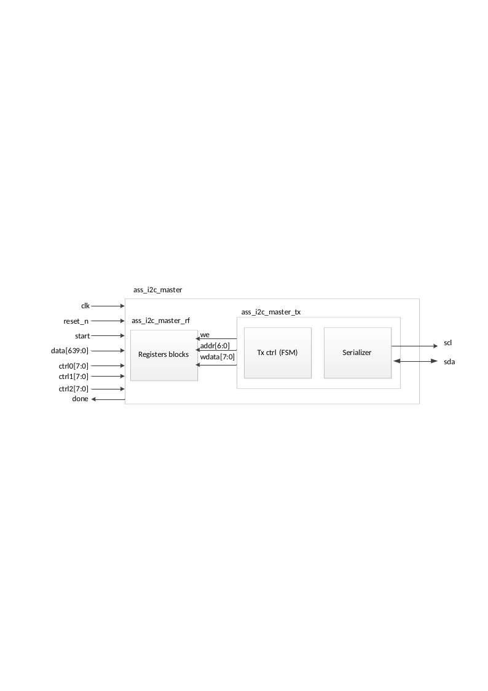
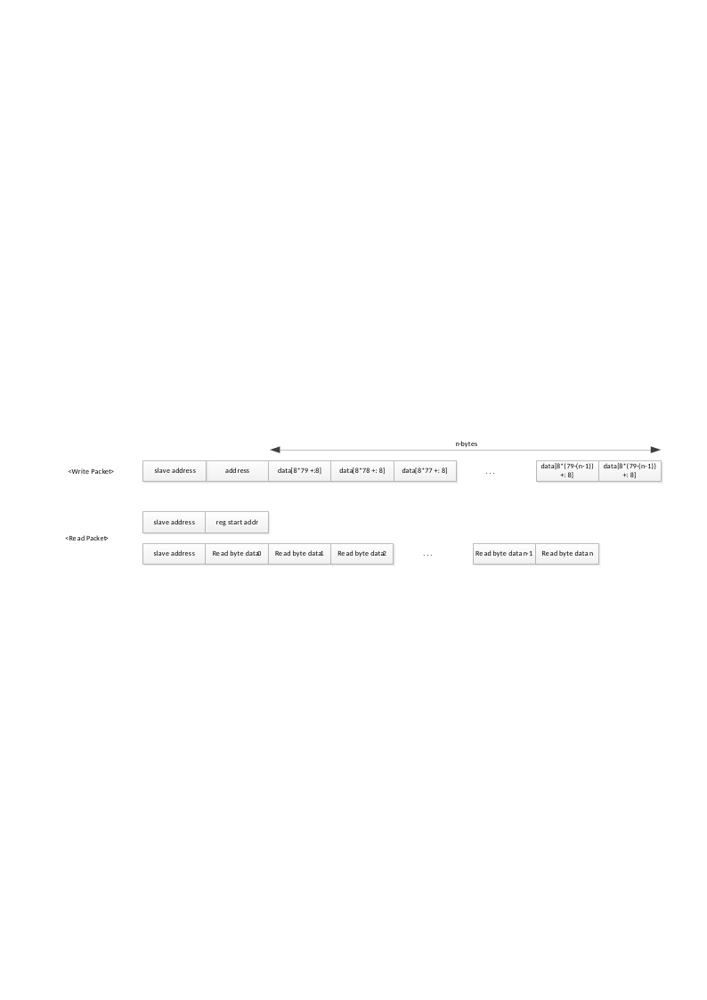
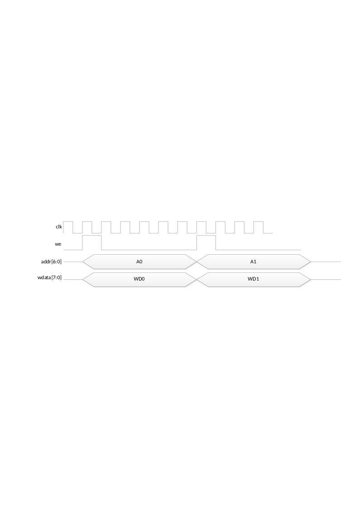
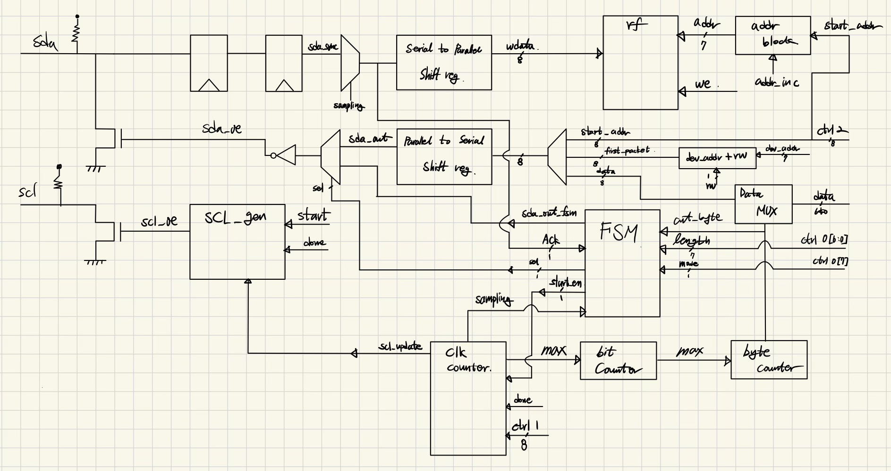
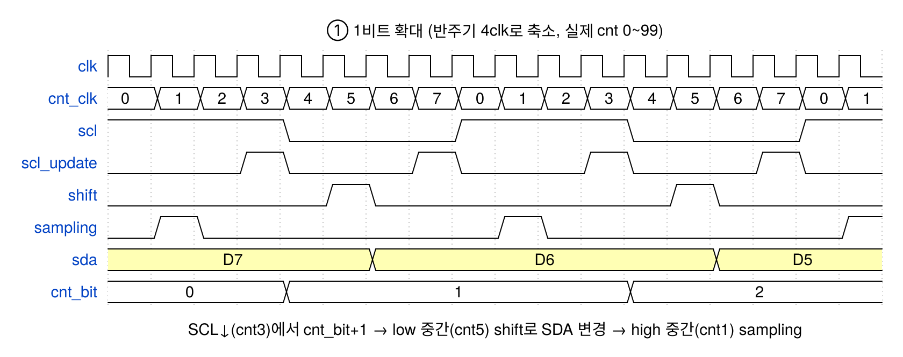
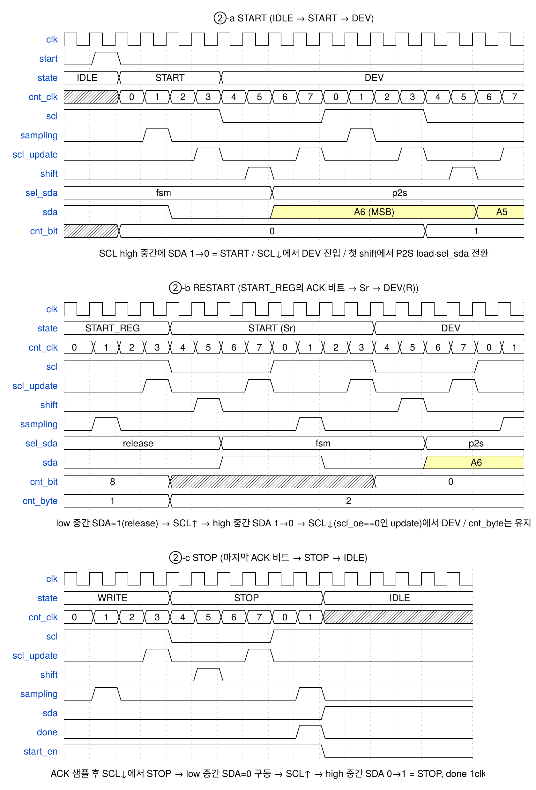
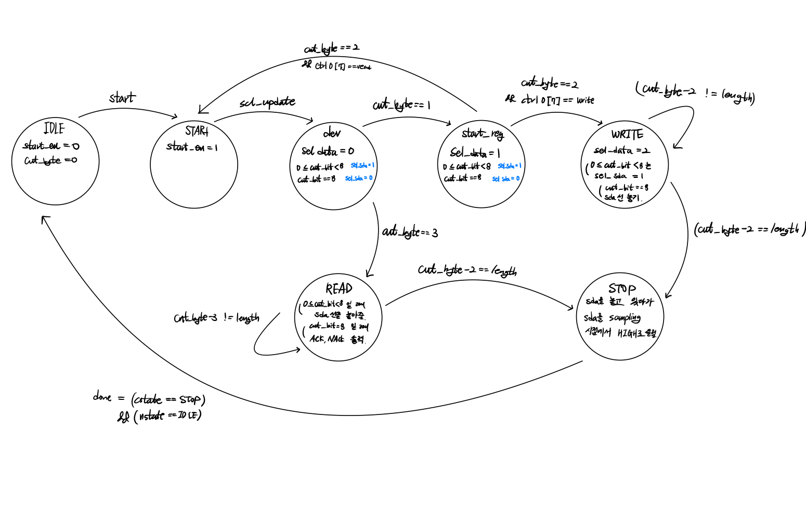
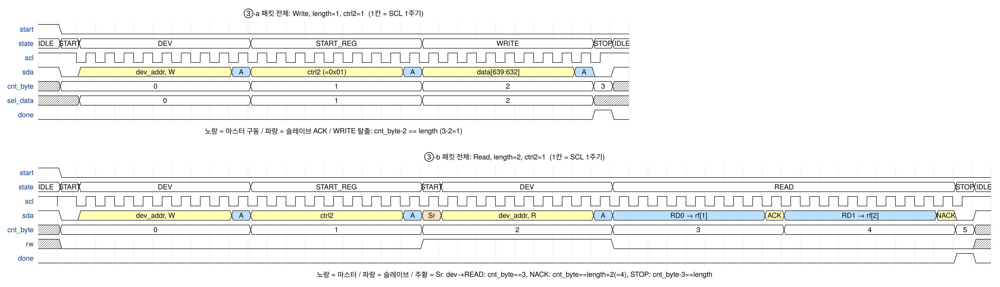
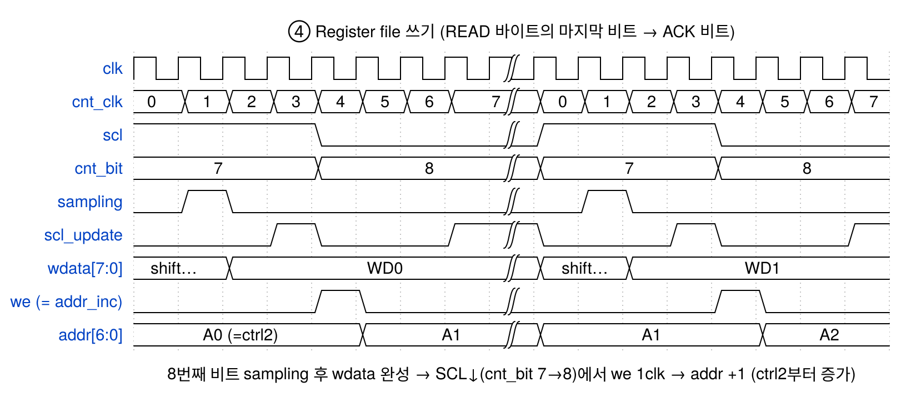

# I2C Master TX (Assignment 6) — 설계 컨텍스트

> Claude와 나눈 설계 리뷰 대화(2026-11-19 ~ 11-20)를 정리한 문서. 코드 작업할 때 이 문서를 기준으로 진행한다.
> 이미지: `docs/img/`, WaveDrom 소스: `docs/wavedrom/` (`python gen.py` → `npx wavedrom-cli -i wX.json -s wX.svg`)

---

## 0. 현재 상태 / TODO

- [ ] **FSM `READ → STOP` 조건을 `cnt_byte - 3 == length`로 수정** (손그림 FSM에는 아직 `-2`로 남아 있음. 루프 조건 `-3 !=`와 짝이 맞아야 함)
- [ ] `sda_out_fsm`은 **oe 극성(1 = SDA를 0으로 당김, 0 = release)** 으로 가기로 결정 → §6 코드대로 READ/default/START(shift) 수정
- [ ] oe 극성이므로 **P2S 출력은 반전해서 MUX에 넣기** (`sel_sda ? ~sda_out : sda_out_fsm`)
- [ ] `sel_sda`를 조합 논리 → **shift 펄스에서 갱신되는 레지스터**로 변경 (§6)
- [ ] START → DEV 전이 조건: `scl_update && scl_oe == 0` (SCL을 *내리는* update) + START에서 `cnt_bit` 클리어
- [ ] `cnt_byte` 클리어는 IDLE에서만 (RESTART에서 리셋하지 않음 — FSM 조건이 이걸 전제로 함)
- [ ] P2S `load`는 각 바이트의 **첫 shift (cnt_bit==0)** 에서
- [ ] `ass_i2c_master_rf.v`: `reg [7:0] rf [0:127]` 뒤 **세미콜론 누락**
- [ ] tb 계층 이름 맞추기: `dut.tx.ctrl.fsm.state` (3비트, **IDLE = 3'd0**), `dut.u_rf.rf[]` (§1)

---

## 1. 스펙 요약 (docs/assignment_6_tx.docx)



- `start` 펄스 → ctrl0~2 정보로 동작 → 끝나면 `done` 펄스
- **클럭은 `clk` 하나뿐인 synchronous design** (scl/sda는 신호로 취급)

| reg | bits | 설명 |
|---|---|---|
| ctrl0 | [7] | 0 = write, 1 = read |
| ctrl0 | [6:0] | byte length (0~80) |
| ctrl1 | [7:0] | I2C 속도 (clk 분주값) |
| ctrl2 | [7:0] | start address (0~127) |

**Packet format**



- Write: `{dev,W}` · `ctrl2` · `data[8*79+:8]` · `data[8*78+:8]` … (MSB 바이트부터)
- Read: 프레임 2개 — `{dev,W}` · `ctrl2` → **repeated START** → `{dev,R}` · RD0 · RD1 … (마지막은 NACK) → STOP
- Read 데이터는 register file에 `ctrl2` 주소부터 저장 (`we`, `addr[6:0]`, `wdata[7:0]`)



### tb_tx.v에서 확인한 사실
- `clk` 100 MHz (10 ns), `ctrl1 = i2c_freq/clock_freq = 1000/10 = 100` → **SCL 1주기 = 100 clk** (반주기 50)
- `dev_adr = 7'h45` — **top 포트로 들어옴** (ctrl 레지스터 아님)
- top 포트 이름: `clk, rstb, dev_adr, start, data, ctrl0, ctrl1, ctrl2, done, scl, sda`
- 테스트: Write 8바이트(ctrl2=1) → `u_slave_model.mem[1..8]` 비교, Read 8바이트(ctrl2=1) → `dut.u_rf.rf[1..8]` 비교
- `run_i2c_master_top`: `wait(dut.tx.ctrl.fsm.state == 3'd0)` → start 1clk → `@(posedge done)` (**start 한 번에 Read 두 프레임 전부 처리해야 함**)
- (주석 처리된 예전 tb에 `ctrl0 = {1'b1, 8'd8}` 9비트 → 잘려서 write가 되는 버그가 있었음. 현재 tb는 `{1'b1, 7'd8}`로 수정됨)
- `pullup(scl); pullup(sda);` → 오픈드레인

### i2c_slave_model.v 특징 (검증 시 참고)
- START 검출: `negedge sda`에서 `sta <= scl` / STOP 검출: `posedge sda`에서 `sto <= scl`
  → **SCL high에서 SDA가 바뀌면 바로 START/STOP으로 인식**. SDA 변경을 SCL↓와 같은 클럭에 하면 오인식 위험 → SDA는 SCL low 중간(shift)에만 변경
- 데이터 샘플: `posedge scl`, 상태 전이/ACK 구동: `negedge scl`
- Read(rw=1)면 dev ACK 후 바로 데이터 전송 (reg addr 없음) → 2-프레임 Read 구조와 일치

---

## 2. 계층 / 블록별 I/O

```
ass_i2c_master (top)
├── ass_i2c_master_rf      (u_rf)
└── ass_i2c_master_tx      (tx)
    ├── tx_ctrl            (ctrl) ── fsm (state)
    └── serializer / counters ...
```

| 블록 | in | out |
|---|---|---|
| top | clk, rstb, dev_adr[6:0], start, data[639:0], ctrl0/1/2[7:0] | done, scl, sda(inout) |
| rf | clk, we, addr[6:0], wdata[7:0] | (없음, tb가 `rf[]` 직접 확인) |
| tx | clk, rstb, start, dev_adr, data, ctrl0/1/2 | we, addr, wdata, done, scl, sda |
| FSM | start, ctrl0[7](mode), ctrl0[6:0](length), cnt_bit, cnt_byte, ack, sampling, scl_fall | start_en, sel_data[1:0], sel_sda, sda_out_fsm, rw, p2s_load, s2p_en, bit_clr, byte_clr, we(=addr_inc), done |
| clk counter | start_en, ctrl1 | scl_update, sampling, shift |
| SCL_gen | start, done, scl_update | scl_oe, scl_fall (= scl_update & ~scl_oe) |
| bit counter | scl_fall, bit_clr | cnt_bit[3:0] |
| byte counter | scl_fall && cnt_bit==8, byte_clr | cnt_byte[6:0] |
| 2-FF sync | sda | sda_sync |
| S2P | sda_sync, sampling, s2p_en | wdata[7:0] |
| ACK 캡처 | sda_sync, sampling | ack |
| Data MUX | data[639:0], cnt_byte | data_byte = `data[8*(79-(cnt_byte-2)) +: 8]` |
| dev_addr+rw | dev_adr, rw | first_packet = {dev_adr, rw} |
| Byte MUX | first_packet, ctrl2, data_byte, sel_data | tx_byte[7:0] |
| P2S | tx_byte, p2s_load, shift | sda_out (= q[7]) |
| SDA MUX | sda_out, sda_out_fsm, sel_sda | sda_oe |
| addr block | ctrl2[6:0], byte_clr(로드), addr_inc | addr[6:0] |

---

## 3. 데이터패스 (손그림 최종본)



- **수신**: sda → 2-FF sync → `sda_sync` → (sampling 시) S2P → `wdata` → rf. ACK는 sampling 지점에서 바로 FSM으로
- **송신**: Byte MUX(`start_addr`=ctrl2 / `first_packet`={dev_addr,rw} / `data`) → P2S → SDA MUX(`sda_out` / `sda_out_fsm`, sel=`sel_sda`) → (극성 처리) → 오픈드레인 `sda_oe`
- **SCL**: clk counter(ctrl1) → `scl_update` → SCL_gen → `scl_oe`
- **카운터**: bit counter (0~8, 9비트/바이트), byte counter (`cnt_byte`)
- **rf 주소**: addr block (ctrl2 로드, `addr_inc`로 +1)
- 출력단: `assign sda = sda_oe ? 1'b0 : 1'bz; assign scl = scl_oe ? 1'b0 : 1'bz;`

---

## 4. 타이밍 규칙 (가장 중요)

1. **SCL high 동안 SDA 고정.** 의도적인 START/STOP/RESTART 때만 바꿈 (high 중간 = `sampling` 시점)
2. **데이터 비트 변경은 SCL low 중간 (`shift`)** — SCL↓와 같은 클럭에 바꾸면 slave model이 START/STOP으로 오인식할 수 있음
3. **P2S 출력, `sda_out_fsm`, `sel_sda` 모두 shift(또는 START/STOP의 sampling) 펄스에서만 갱신** → SDA는 항상 low 중간에만 변함
4. **cnt_bit / cnt_byte는 SCL을 내리는 `scl_update`(scl_fall)에서 증가**. START→DEV, STOP 진입도 이 시점
5. 1바이트 = 9비트 (cnt_bit 0~7 데이터, 8 ACK)

### clk counter (SCL 1주기 = 100 clk, ctrl1=100)

| cnt_clk | SCL | 이벤트 |
|---|---|---|
| 0~49 | H | |
| 24 | H | `sampling` (읽기, START/STOP의 SDA 변경) |
| 49 | H→L | `scl_update` (SCL↓ = scl_fall) → cnt_bit+1 |
| 50~99 | L | |
| 74 | L | `shift` (SDA 변경, P2S shift/load) |
| 99 | L→H | `scl_update` (SCL↑) |

※ 타이밍도는 반주기 4clk로 축소: cnt 1→24, 3→49, 5→74, 7→99



### SCL_gen
```verilog
always @(posedge clk or negedge rstb)
  if (!rstb)               scl_oe <= 1'b0;     // release = SCL high
  else if (start || done)  scl_oe <= 1'b0;
  else if (scl_update)     scl_oe <= ~scl_oe;
```
- hold 기능 불필요: START/STOP/RESTART는 SCL high 중간(sampling)에 SDA를 바꿔서 구현
- `done`은 STOP의 SDA↑ 직후, **다음 scl_update 전에** 와야 함

### START / RESTART / STOP



- **START** (IDLE→START): SCL high에서 시작 → sampling에서 SDA 1→0 → SCL↓에서 DEV
- **RESTART** (START_REG ACK 후 START 재사용): SCL low에서 진입 → shift에서 SDA release(1) → SCL↑ → sampling에서 SDA 1→0 → SCL↓에서 DEV. 진입 직후 첫 scl_update는 SCL을 *올리는* 것이므로 전이 조건은 `scl_update && scl_oe==0`
- **STOP**: SCL↓에서 진입 → shift에서 SDA를 0으로 잡음(슬레이브 ACK/NACK 뒤라도 마스터가 직접 0 구동 필요) → SCL↑ → sampling에서 release → SDA 0→1 → done → IDLE. `start_en=0`은 IDLE에서 (STOP 진입 시 끄면 SCL이 low로 멈춤)

---

## 5. FSM



상태: `IDLE(=3'd0), START, DEV_ADDR, REG_ADDR(start_reg), WRITE, READ, STOP` (tb가 `state == 3'd0`을 IDLE로 기다림)

| 전이 | 조건 |
|---|---|
| IDLE → START | `start` |
| START → DEV_ADDR | `scl_update && scl_oe==0` (SCL↓) |
| DEV_ADDR → REG_ADDR | `cnt_byte == 1` |
| DEV_ADDR → READ | `cnt_byte == 3` |
| REG_ADDR → WRITE | `cnt_byte == 2 && ctrl0[7] == 0` |
| REG_ADDR → START (RESTART) | `cnt_byte == 2 && ctrl0[7] == 1` |
| WRITE → WRITE | `cnt_byte - 2 != length` |
| WRITE → STOP | `cnt_byte - 2 == length` (length=0이면 진입 즉시 STOP) |
| READ → READ | `cnt_byte - 3 != length` |
| READ → STOP | **`cnt_byte - 3 == length`** ← 손그림은 `-2`, 수정 필요 |
| STOP → IDLE | STOP의 SDA↑ 완료 |

- **cnt_byte는 IDLE에서만 클리어** (RESTART에서 유지) — 이 덕분에 `rep` 플래그 없이 dev 두 패스를 구분
- `done = (cstate == STOP) && (nstate == IDLE)` (1clk 펄스)
- `rw_bit = ctrl0[7] & (cnt_byte == 2)` (DEV(R) 동안만 1)
- `last_rd = (cnt_byte == length + 2)` → READ 마지막 바이트의 ACK 비트에서 NACK
- `sel_data`: DEV=0(first_packet), REG=1(ctrl2), WRITE=2(data)

### 바이트 인덱스 (cnt_byte = 바이트 *진행 중* 값)

Write, length=1:

| 상태 | DEV | REG | WRITE | STOP |
|---|---|---|---|---|
| cnt_byte | 0 | 1 | 2 | 3 |

Read, length=2:

| 상태 | DEV(W) | REG | START(Sr) | DEV(R) | READ | READ | STOP |
|---|---|---|---|---|---|---|---|
| cnt_byte | 0 | 1 | 2 | 2 | 3 (ACK) | 4 (NACK) | 5 |



---

## 6. SDA 출력 로직 (oe 극성: 1 = 당김, 0 = release)

```verilog
wire last_rd = (cnt_byte - 7'd2 == length);   // == length + 2

always @(posedge clk or negedge rstb) begin
  if (!rstb) sda_out_fsm <= 1'b0;                      // idle = release
  else case (cstate)
    START   : if      (shift)    sda_out_fsm <= 1'b0;  // Sr 준비: release
              else if (sampling) sda_out_fsm <= 1'b1;  // 당김 → START
    READ    : if (shift) sda_out_fsm <= (cnt_bit == 4'd8) ? ~last_rd : 1'b0;
                                                       // 데이터=release, ACK=당김, 마지막 NACK=release
    STOP    : if      (shift)    sda_out_fsm <= 1'b1;  // 0으로 잡기
              else if (sampling) sda_out_fsm <= 1'b0;  // release → STOP
    default : if (shift) sda_out_fsm <= 1'b0;          // DEV/REG/WRITE의 ACK 비트 = release
  endcase
end

// sel_sda: 1 = P2S, 0 = fsm.  shift 타이밍에 갱신 (SCL↓와 겹치지 않게)
always @(posedge clk or negedge rstb)
  if (!rstb)      sel_sda <= 1'b0;
  else if (shift) sel_sda <= ((cstate==DEV_ADDR) || (cstate==REG_ADDR) || (cstate==WRITE))
                             && (cnt_bit != 4'd8);

// P2S 출력(q[7])은 데이터 레벨이므로 oe 극성에 맞게 반전
assign sda_oe = sel_sda ? ~sda_out : sda_out_fsm;
assign sda    = sda_oe ? 1'b0 : 1'bz;
```

| 구간 | 이벤트 | sda_out_fsm (oe) | SDA |
|---|---|---|---|
| START | sampling | 0→1 | 1→0 |
| DEV/REG/WRITE ACK 비트 | shift | 0 | release (슬레이브 ACK) |
| START(Sr) | shift → sampling | 0 → 1 | 1 → 0 |
| READ 데이터 | shift | 0 | release (슬레이브 구동) |
| READ ACK (마지막 아님) | shift | 1 | 0 (ACK) |
| READ 마지막 ACK 비트 | shift | 0 | 1 (NACK) |
| STOP | shift → sampling | 1 → 0 | 0 → 1 |

---

## 7. P2S / S2P / RF 쓰기

### P2S (비트마다 MUX + D-FF, load > shift > hold)
```verilog
always @(posedge clk or negedge rstb)
  if (!rstb)       q <= 8'd0;
  else if (load)   q <= tx_byte;          // 각 바이트 첫 shift(cnt_bit==0)에서
  else if (shift)  q <= {q[6:0], 1'b0};
assign sda_out = q[7];                    // MSB first
```

### S2P
- `sampling && s2p_en`일 때 `{wdata[6:0], sda_sync}` 시프트
- `s2p_en` = READ 상태 && cnt_bit < 8 (ACK 비트는 시프트하지 않음 → wdata 보존)
- `sda_sync`는 2clk 지연 — sampling은 SCL high 중간이라 여유 충분

### RF 쓰기
- READ에서 cnt_bit 7→8 (SCL↓) 순간 `we` 1clk, 같은 펄스로 `addr_inc` → addr = ctrl2, ctrl2+1, …



---

## 8. 대화 중 결정 사항 / 이유 메모

- **SDA MUX 입력은 2개** (P2S / fsm). release 전용 입력은 없애고 fsm이 release 값을 냄
- **`rep` 플래그 대신 cnt_byte를 RESTART에서 유지**하는 방식 채택 (dev 출구를 `cnt_byte==1` / `==3`으로 구분)
- REG_ADDR 분기는 출구 시점이 같으므로 반드시 `ctrl0[7]`로 구분 (cnt_byte만으로는 불가)
- `rw`를 ctrl0[7]에 직결하면 Read 1차 프레임도 R로 나가서 실패 → `rw_bit = ctrl0[7] & (cnt_byte==2)`
- shift를 sampling(high 중간)에 하면 안 되는 이유: SCL high에서 SDA 변경 = START/STOP
- 극성: `sda_out_fsm`은 oe 극성 유지 (사용자 결정), 대신 P2S 쪽을 반전
